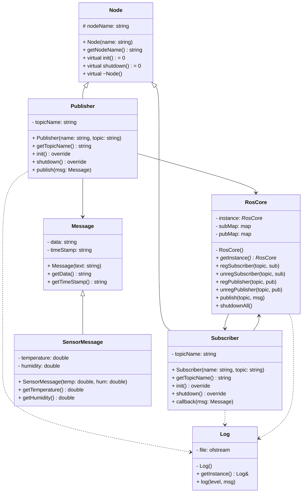

# ROS简易消息仿真系统设计文档

## 1. 项目介绍
本项目模拟ROS机器人操作系统的核心通信逻辑，实现简化版的发布-订阅消息机制。系统包含核心管理器、节点、发布者、订阅者、消息载体，完成消息的发布、话题匹配、消息转发与接收。

## 2. 开发环境
编程语言：C++
开发工具：VSCode、MinGW-w64、Git、Draw.io
版本管理：GitHub远程仓库，增量提交代码与文档

## 3. 基础功能设计
1. 消息类 Message：作为数据载体，承载通信需要传输的数据内容，并在构造时自动生成时间戳。
2. 发布者 Publisher：属于节点的一种，绑定指定话题，向系统核心发送消息。
3. 订阅者 Subscriber：属于节点的一种，订阅指定话题，接收核心转发的对应话题消息并回调处理。
4. RosCore 核心管理器：作为消息调度中心，维护话题列表，保存话题与发布者、订阅者的映射关系，接收发布者消息并转发给该话题下所有订阅者。

## 4. 加分功能设计
1. RosCore 采用单例模式：全局仅允许存在一个实例，构造函数私有化，禁止外部直接创建对象。
2. Node 设计为抽象基类：不能直接实例化，仅作为父类定义 init()、shutdown() 生命周期接口，由 Publisher、Subscriber 继承实现。
3. Message 数据只读保护：内部数据私有，对外只提供 const 读取接口，防止传输过程中被意外篡改。
4. 自定义异常机制：定义 NodeException、TopicException、MessageException 三类异常。对空节点名、重复节点注册、空话题、向不存在话题发消息、空消息发布等非法场景抛出对应异常；程序捕获异常后输出错误日志，程序不崩溃。
5. 分级日志模块 Log（单例）：支持 INFO / WARN / ERROR 三级，日志同时输出控制台并持久化写入 log.txt，便于运行信息追溯。
6. 扩展消息类型：派生 SensorMessage，在基础消息之上携带温度、湿度，时间戳由父类自动生成，模拟传感器上报数据。

## 5. 类结构说明
- RosCore：全局调度核心，单例类。成员包含话题-订阅者映射表 subMap、话题-发布者映射表 pubMap；成员函数有获取实例、注册/注销节点、转发消息、全局关闭。
- Node：抽象基类。成员包含节点名称 nodeName；纯虚函数 init()、shutdown() 作为节点生命周期接口，无法直接实例化。
- Publisher：公有继承 Node。成员包含绑定话题 topicName；成员函数用于注册、注销、发布消息。
- Subscriber：公有继承 Node。成员包含订阅话题 topicName；成员函数用于注册、注销、消息回调处理。
- Message：消息载体类。私有成员保存数据 data 与时间戳 timeStamp，对外只有 const 读取接口。
- SensorMessage : public Message：扩展传感器消息，增加温度 temperature、湿度 humidity 字段。
- Log：日志单例类，提供分级日志输出，支持控制台 + 文件双输出。
- NodeException / TopicException / MessageException：自定义异常类，均继承 std::exception。

## 6. UML类图

## 7. 测试方案
1. 基础通信测试：创建发布者和同一话题的订阅者，发布消息，验证订阅者能否正常收到消息。
2. 多订阅者测试：同一话题多个订阅者，发布一条消息，全部订阅者都收到。
3. 单例测试：两次获取 RosCore，验证得到的是同一个对象。
4. 抽象类测试：尝试直接创建 Node 对象会编译报错，证明抽象类不可实例化。
5. 只读测试：Message 内部数据只有 const 读取接口，外部无法修改。
6. 异常测试：
   - 注册空名称节点 → NodeException
   - 重复注册同一节点 → NodeException
   - 订阅/发布空话题、向不存在订阅者的话题发送消息 → TopicException
   - 发布空消息 → MessageException
   所有异常场景程序可正常捕获并提示，不会崩溃。
7. 扩展消息测试：构造 SensorMessage，验证温度、湿度、时间戳能随消息传到订阅端。

## 8. 项目总结
本项目实现了简化 ROS 发布订阅通信模型，通过继承、抽象类、单例模式完成设计，同时增加数据只读保护、自定义异常、分级持久化日志、传感器扩展消息等加分功能，提升代码健壮性。
开发过程使用 Git 进行版本管理，采用增量开发方式，分步提交代码与文档，每一步提交记录清晰，便于追溯修改。
项目模拟了 ROS 通信思想，加深了对面向对象设计、消息驱动通信的理解。后续可拓展多线程、消息队列、服务同步应答等功能。