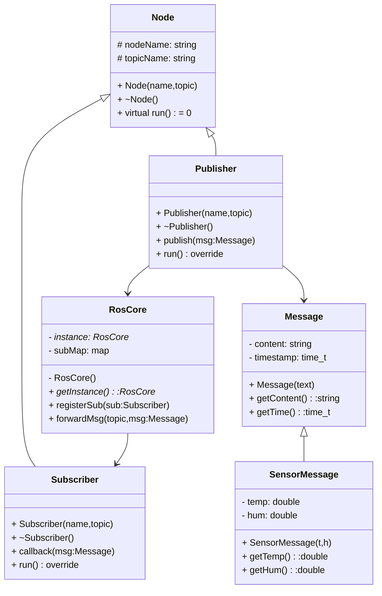

护和异常处# ROS简易消息仿真系统设计文档

## 1. 项目介绍
本项目模拟ROS机器人操作系统的核心通信逻辑，实现简化版的发布-订阅消息机制。系统包含核心管理器、节点、发布者、订阅者、消息载体，完成消息的发布、话题匹配、消息转发与接收，实现节点间异步通信仿真。

## 2. 开发环境
编程语言：C++
开发工具：VSCode、MinGW-w64、Git、Draw.io
版本管理：GitHub远程仓库，增量提交代码与文档

## 3. 基础功能设计
1. 消息类Message：作为数据载体，承载通信需要传输的数据内容。
2. 发布者Publisher：属于节点的一种，绑定指定话题，向系统核心发送消息。
3. 订阅者Subscriber：属于节点的一种，订阅指定话题，接收核心转发的对应话题消息。
4. RosCore核心管理器：作为消息调度中心，维护话题列表，保存话题与订阅者的映射关系，接收发布者消息并转发给该话题下所有订阅者。

## 4. 加分功能设计
1. RosCore采用单例模式：全局仅允许存在一个RosCore实例，构造函数私有化，禁止外部直接创建对象，保证全局通信中心唯一。
2. Node设计为抽象基类：不能直接实例化，仅作为父类，定义节点通用接口，由Publisher、Subscriber继承实现。
3. Message数据只读保护：内部存储的数据对外只提供读取接口，不提供修改接口，防止消息在传输过程中被意外篡改。
4. 自定义异常机制：定义`NodeException`、`TopicException`、`MessageException`三类异常。对空节点名、重复节点注册、空话题、向不存在话题发消息、空消息发布等非法场景抛出对应异常；程序捕获异常后输出分级日志，程序不崩溃，提升鲁棒性。
5. 分级日志模块Logger（单例）：支持INFO/WARN/ERROR三级日志，日志同时输出控制台、持久化写入log.txt文件，方便运行信息追溯。
6. 扩展消息类型：派生SensorMessage，携带温度、湿度、时间戳，模拟传感器上报数据。

## 5. 类结构说明
- RosCore：全局调度核心，单例类。成员包含话题-订阅者映射表、已注册节点集合；成员函数有获取实例、注册节点、注销节点、注册话题、转发消息、全局关闭等。
- Node：抽象基类。成员包含节点名称；包含纯虚函数init()、shutdown()，作为节点生命周期接口，无法直接实例化。
- Publisher：公有继承Node。成员包含绑定话题；成员函数用于构造消息、发布消息。
- Subscriber：公有继承Node。成员包含订阅话题；成员函数用于接收消息、消息回调处理。
- Message：消息载体类。私有成员保存数据，对外只有const读取接口，数据不可修改。
- SensorMessage : public Message：扩展传感器消息，增加温度、湿度、时间戳字段。
- Logger：日志单例类，提供分级日志输出，支持控制台+文件双输出。
- NodeException / TopicException / MessageException：自定义异常类，继承std::exception。

## 6. UML类图

## 7. 测试方案
1. 基础通信测试：创建发布者和同一话题的订阅者，发布消息，验证订阅者能否正常收到消息。
2. 多订阅者测试：同一个话题多个订阅者，发布一条消息，全部订阅者都收到消息。
3. 单例测试：尝试多次获取RosCore，验证得到的是同一个对象。
4. 抽象类测试：尝试直接new Node，编译报错，证明抽象类不可实例化。
5. 只读测试：尝试在外部修改Message内部数据，编译报错。
6. 异常测试：
   - 注册空名称节点 → NodeException
   - 重复注册同名节点 → NodeException
   - 订阅/发布空话题、向不存在话题发送消息 → TopicException
   - 发布空消息 → MessageException
   所有异常场景程序可以正常捕获并提示，不会崩溃。

## 8. 项目总结
本项目实现了简化ROS发布订阅通信模型，通过面向对象的继承、抽象类、单例模式完成设计，同时增加数据只读保护、自定义异常、分级持久化日志等加分功能，提升代码健壮性。
开发过程使用Git进行版本管理，采用增量开发方式，分步提交代码与文档，每一步提交记录清晰，便于追溯修改。项目模拟了ROS通信思想，加深了对面向对象设计、消息驱动异步通信的理解。后续可以拓展多线程、消息队列、服务同步应答等功能。
理提升代码健壮性。开发过程使用Git进行版本管理，分步提交文档与代码，方便追溯修改。项目模拟了ROS通信思想，加深了对面向对象设计、消息驱动通信的理解。后续可以拓展多线程、消息队列等功能。
