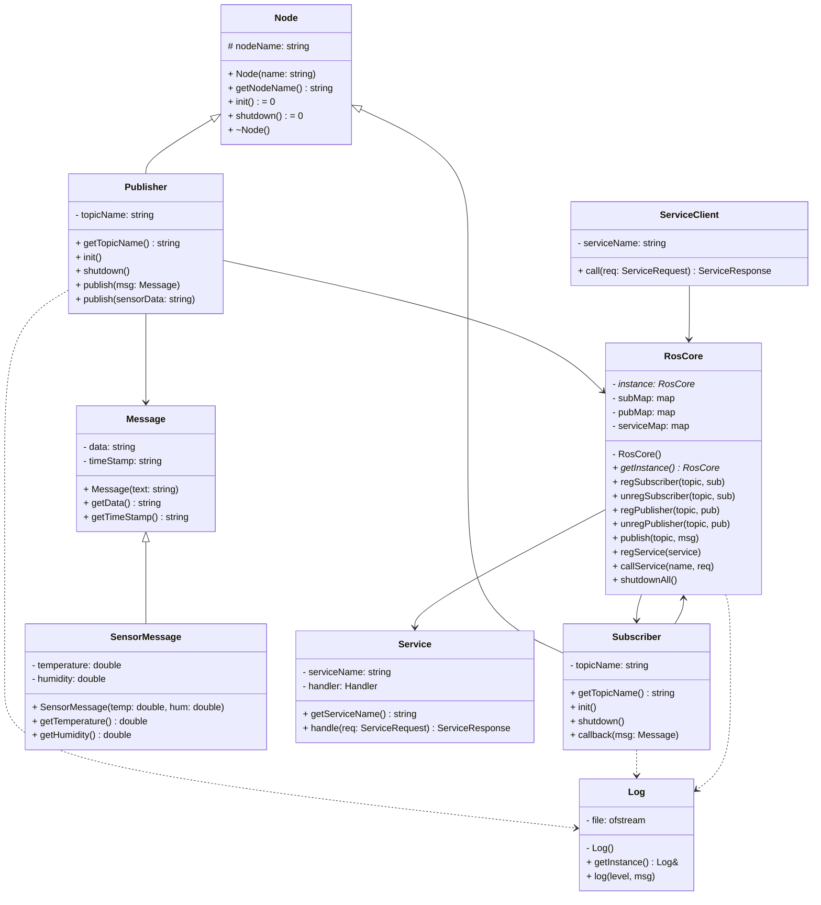

# 架构设计文档

## 1. 项目介绍
本项目模拟 ROS 机器人操作系统的核心通信逻辑，实现简化版的发布-订阅消息机制，并在其之上补充了服务端/客户端同步请求-响应通信、运行时动态增删节点、自定义异常体系与分级持久化日志。
系统包含核心管理器、节点、发布者、订阅者、消息载体、服务与日志模块，完成消息的发布、话题匹配、消息转发与被动接收。

## 2. 开发环境
- 编程语言：C++（C++11 标准）
- 开发工具：VSCode、MinGW-w64 g++、Git
- 版本管理：GitHub 远程仓库，增量提交代码与文档
- 运行平台：Windows 控制台

## 3. 基础模块设计
1. **Message 消息类**：作为数据载体，封装字符串消息内容，构造时自动生成 `YYYY-MM-DD HH:MM:SS` 时间戳，只提供 const 只读访问接口。
2. **Publisher 发布者**：继承 Node，绑定指定话题；初始化时向核心注册，关闭时注销；发布接口支持"接收传感器字符串 → 内部创建 Message → 转发"。
3. **Subscriber 订阅者**：继承 Node，订阅指定话题；接收核心转发的消息并回调处理，输出含内容与时间戳的日志。
4. **RosCore 核心管理器**：单例，维护"话题-发布者""话题-订阅者"两张映射表，接收发布者消息并转发给该话题下所有订阅者；提供统一关闭方法。

## 4. 加分功能设计
1. **RosCore 单例模式**：构造函数私有化，全局唯一实例，禁止外部直接创建对象。
2. **Node 抽象基类**：纯虚 `init()` / `shutdown()`，不可直接实例化，统一节点行为规范。
3. **Message 数据只读保护**：私有成员 + const 读取接口，防止传输过程中被篡改。
4. **自定义异常体系**：`NodeException`、`TopicException`、`MessageException`、`ServiceException` 四类，覆盖空节点名、重复注册、空话题、空消息、无订阅者转发、服务不存在等非法场景。
5. **全局异常捕获**：main 中统一封装 runCase，单场景异常不中断后续场景，程序不崩溃。
6. **分级日志模块 Log（单例）**：INFO / WARN / ERROR 三级，同时输出控制台与 `log.txt`。
7. **扩展消息类型 SensorMessage**：在基础消息之上携带温度、湿度（时间戳由父类生成）。
8. **服务 / 客户端同步通信**：Service 服务端 + ServiceClient 客户端 + RosCore 服务注册表，客户端调用阻塞等待响应。
9. **运行时动态增删节点**：注册 / 注销接口可在程序运行期调用，映射表实时更新。

## 5. 类结构说明
| 类 | 职责 | 关键成员 |
| --- | --- | --- |
| Node | 抽象节点基类 | `nodeName`、`init()`、`shutdown()`、虚析构 |
| Publisher | 发布者节点 | `topicName`、`publish(Message)`、`publish(string)` |
| Subscriber | 订阅者节点 | `topicName`、`callback(Message)` |
| Message | 消息载体 | `data`、`timeStamp`、`getData()`、`getTimeStamp()` |
| SensorMessage | 传感器扩展消息 | `temperature`、`humidity` |
| RosCore | 全局调度核心（单例） | `subMap`、`pubMap`、`serviceMap`、注册/注销/转发/服务调用/全局关闭 |
| Service | 服务端 | `serviceName`、`Handler`、`handle()` |
| ServiceClient | 服务客户端 | `serviceName`、`call()` |
| Log | 分级日志（单例） | `file`、`log(level,msg)` |
| NodeException 等 | 四类自定义异常 | 继承 `std::exception`，重写 `what()` |

## 6. UML 类图


## 7. 分层与调用关系
```
                  main.cpp（场景编排 + 统一异常捕获）
                            │
        ┌───────────────────┼────────────────────┐
   Publisher            Subscriber            ServiceClient
        │                   │                     │
        └────────────► RosCore（单例调度）◄─────────┘
                            │
                  Log（分级日志） / RosException（异常）
                            │
                    Message / SensorMessage
```
调用方向自上而下，下层不反向依赖上层；`Service.h` 只依赖 `Log.h`，RosCore 与 Service 的双向依赖通过把 `ServiceClient::call` 的实现下沉到 `RosCore.cpp` 解决循环包含。

## 8. 测试方案
1. 基础通信：多发布者、多订阅者同一话题，验证消息广播。
2. 传感器扩展消息：验证温度、湿度、时间戳传递。
3. 服务通信：正常调用与调用不存在服务两类。
4. 动态增删节点：运行时注册、注销订阅者，验证转发目标实时变化。
5. 异常测试：空节点名、空话题、重复注册、空消息、无订阅者转发、服务不存在。
6. 单例验证：两次获取 RosCore 得到同一地址。

## 9. 项目总结
本项目用继承、抽象类、单例、映射表等设计手段，还原了 ROS 发布订阅的核心通信模型，并补齐了服务通信、动态节点管理、异常体系与日志持久化。
代码分层清晰、职责单一，异常与日志贯穿全流程，具备较好的可维护性。
后续可向多线程异步派发、消息队列、参数服务器等方向扩展。